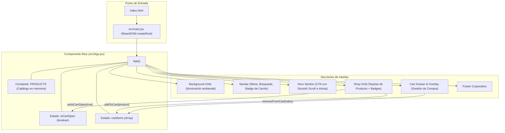

# 📘 Documentación Técnica — Aura Bazar (`bazar-online`)

**Autor:** Roberto Alejandro Chagra Martínez  
**Versión:** 1.0.0  
**Stack Tecnológico:** React 19.2.6 · Vite 8.0.12 · Lucide React 1.17.0 · CSS3 Custom Properties  

---

## 1. Arquitectura de la Aplicación

**Aura Bazar** sigue una arquitectura **Single Page Application (SPA)** declarativa centrada en componentes funcionales de React 19 y hooks de estado local (`useState`). El empaquetado y servidor de desarrollo se gestionan con **Vite**, garantizando recarga instantánea de módulos (*Hot Module Replacement - HMR*).

---

## 2. Componentes y Archivos Clave

- **[`src/main.jsx`](file:///g:/Mi%20unidad/Drive.alumno.udg.mx/Proyectos/bazar-online/src/main.jsx)**: Inicializa la raíz de React 19 dentro de `<StrictMode>` e inyecta los estilos globales.
- **[`src/App.jsx`](file:///g:/Mi%20unidad/Drive.alumno.udg.mx/Proyectos/bazar-online/src/App.jsx)**: Contiene la lógica de negocio del e-commerce, el catálogo estático `PRODUCTS` y las vistas integradas:
  - **Barra de Navegación (`<nav className="navbar">`)**: Renderiza íconos vectoriales de `lucide-react` (`Menu`, `Search`, `ShoppingBag`) y muestra un contador flotante (`cartItems.length`) cuando existen artículos en el carrito.
  - **Sección Hero (`<header className="hero">`)**: Presentación visual con botón de acción que ejecuta `document.getElementById('shop').scrollIntoView({ behavior: 'smooth' })`.
  - **Grilla de Productos (`<main id="shop">`)**: Mapea el arreglo `PRODUCTS` en un layout responsivo `grid-template-columns: repeat(auto-fill, minmax(300px, 1fr))`.
  - **Cajón del Carrito (`.cart-drawer` y `.cart-overlay`)**: Panel lateral deslizable controlado por la clase condicional `open` vinculada al estado `isCartOpen`.
- **[`src/index.css`](file:///g:/Mi%20unidad/Drive.alumno.udg.mx/Proyectos/bazar-online/src/index.css)**: Define el sistema de diseño (tokens de color metálicos `--metal-red`, `--metal-gold-classic`, espaciados `--spacing-*`, tarjetas `.card`, animaciones `.fade-in` y estilos del drawer).
- **[`vite.config.js`](file:///g:/Mi%20unidad/Drive.alumno.udg.mx/Proyectos/bazar-online/vite.config.js)**: Configuración del plugin `@vitejs/plugin-react` para transformación JSX y Fast Refresh.

---

## 3. Modelo de Datos del Catálogo (`PRODUCTS`)

Cada ítem dentro del catálogo en [`src/App.jsx`](file:///g:/Mi%20unidad/Drive.alumno.udg.mx/Proyectos/bazar-online/src/App.jsx#L6-L55) sigue el siguiente contrato estructural:

| Propiedad | Tipo | Descripción | Ejemplo |
| :--- | :--- | :--- | :--- |
| `id` | `number` | Identificador único del producto | `1` |
| `name` | `string` | Nombre comercial de la pieza vintage/Y2K | `'Chaqueta Puffer Y2K Plateada'` |
| `price` | `string` | Precio formateado en pesos mexicanos (MXN) | `'$1,200 MXN'` |
| `image` | `string` | URL de fotografía de alta resolución (Unsplash CDN) | `'https://images.unsplash.com/...'` |
| `badge` | `string` | Etiqueta promocional opcional | `'Nuevo Drop'`, `'Único'`, `'Retro'` |
| `badgeColor` | `string` | Variante cromática del badge (`blue`, `gold`, `red`, `green`) | `'blue'` |

---

## 4. Gestión de Estado y Flujo de Usuario

1. **Adición al Carrito (`addToCart`)**:
   - Definida en [`src/App.jsx`](file:///g:/Mi%20unidad/Drive.alumno.udg.mx/Proyectos/bazar-online/src/App.jsx#L61-L64).
   - Recibe el objeto `product`, realiza una copia inmutable del arreglo actual (`setCartItems([...cartItems, product])`) y abre automáticamente el panel lateral (`setIsCartOpen(true)`).
2. **Eliminación del Carrito (`removeFromCart`)**:
   - Definida en [`src/App.jsx`](file:///g:/Mi%20unidad/Drive.alumno.udg.mx/Proyectos/bazar-online/src/App.jsx#L66-L68).
   - Filtra `cartItems` por índice (`cartItems.filter((_, index) => index !== indexToRemove)`), permitiendo gestionar múltiples unidades del mismo producto de forma independiente.
3. **Cierre del Carrito**:
   - El usuario puede cerrar el carrito haciendo clic en el botón `<X />` del encabezado del drawer o haciendo clic fuera del panel sobre `.cart-overlay`.
